<p align="center">
  
</p>

<p align="center">
  <a href="https://github.com/ishandutta2007/Awesome-Awesome-Awesome"></a>
  <a href="https://discord.gg/jc4xtF58Ve"></a>
  <a href="https://github.com/ishandutta2007/Awesome-Awesome-Awesome"></a>
  <a href="https://github.com/ishandutta2007/Awesome-Document-Management-System-DMS/stargazers"></a>
  <a href="https://github.com/ishandutta2007/Awesome-Document-Management-System-DMS/forks"></a>
  <a href="https://github.com/ishandutta2007/Awesome-Document-Management-System-DMS/issues"></a>
  <a href="#-how-to-contribute"></a>
  <a href="LICENSE"></a>
  <a href="https://github.com/ishandutta2007"></a>
</p>

---

# 📑 Awesome Document Management System (DMS) & Enterprise Content Management (ECM)

> 🌟 **The definitive, curated landscape of Enterprise SaaS platforms and self-hosted open-source solutions for digital document capture, OCR full-text search, regulatory records governance, and paperless archival workflows.**

**Last Updated:** October 2026 🗓️ • **Curated for:** Records Managers, Enterprise Architects, IT Sysadmins, and Privacy-Focused Self-Hosters 🛠️

---

## 🧭 Table of Contents

- [🎯 Overview & Architecture Taxonomy](#-overview--architecture-taxonomy)
- [🌐 Sector Overview & Market Dynamics](#-sector-overview--market-dynamics)
- [☁️ Top SaaS & Hosted Enterprise DMS Platforms](#️-top-saas--hosted-enterprise-dms-platforms)
- [💻 Open-Source & Self-Hosted Document Management Projects](#-open-source--self-hosted-document-management-projects)
- [⚖️ Architecture Decision Matrix: Personal vs. Enterprise EDMS](#️-architecture-decision-matrix-personal-vs-enterprise-edms)
- [🤝 How to Contribute](#-how-to-contribute)
- [⭐ Star History](#-star-history)
- [💖 Support & Sponsoring](#-support--sponsoring)
- [🛡️ Compliance & Security Disclaimer](#️-compliance--security-disclaimer)

---

## 🎯 Overview & Architecture Taxonomy

Modern **Document Management Systems (DMS)** and **Enterprise Content Management (ECM)** platforms have evolved far beyond passive digital filing cabinets. Today's architectures orchestrate the complete document lifecycle across three foundational pillars:

```
┌─────────────────────────────────────────────────────────────────────────────┐
│                       DOCUMENT MANAGEMENT LIFECYCLE                         │
├───────────────────────┬─────────────────────────────┬───────────────────────┤
│  📥 INGESTION & OCR   │    🗂️ INDEX & GOVERNANCE    │ 🔍 RETRIEVAL & AUDIT  │
├───────────────────────┼─────────────────────────────┼───────────────────────┤
│ • Scanner / Email / API│ • Metadata Schema & Tagging │ • Sub-Second Full Text│
│ • Optical Char. Recog │ • Role-Based Access (RBAC)  │ • Version Control     │
│ • Layout & PDF Parse  │ • Retention & Legal Hold    │ • Audit Logs & E-Sign │
└───────────────────────┴─────────────────────────────┴───────────────────────┘
```

1. **Intelligent Capture & OCR 📥**: Ingesting physical paper scans, email attachments, invoices, and digital PDFs with automated text extraction, table recognition, and smart categorization.
2. **Indexing, Metadata & Lifecycle Governance 🗂️**: Enforcing compliance policies (GDPR, HIPAA, CCPA, 21 CFR Part 11, DoD 5015.02), automated retention schedules, and cryptographic tamper-evident audit logs.
3. **Omnichannel Retrieval & Automation 🔍**: Semantic vector search, full-text queries, custom approval workflows, WebDAV/CMIS integrations, and REST API orchestration.

---

## 🌐 Sector Overview & Market Dynamics

The global **Document Management System (DMS)** market reached an estimated **$9.7 billion to $10.6 billion in 2026** (growing at a compound annual growth rate of **~12.8%**), while the broader **Enterprise Content Management (ECM)** and Content Services platform sector exceeds **$52 billion**. 

The sector displays a **moderately fragmented** market structure rather than a winner-take-all monopoly. While hyper-scale technology leaders (Adobe, IBM, Box, Microsoft) capture broad horizontal document creation, cloud storage, and baseline office collaboration, deep enterprise requirements create impenetrable moats for specialized vendors. High-consequence regulatory compliance standards (e.g., electronic discovery, legal holds, HIPAA in healthcare, and strict sovereign data residency rules) enable specialized mid-to-large ECM vendors (OpenText, Hyland, Laserfiche, NetDocuments) and security-first open-source self-hosted solutions (Paperless-ngx, Mayan EDMS) to command fiercely loyal, high-retention market segments.

---

## ☁️ Top SaaS & Hosted Enterprise DMS Platforms

The table below catalogs top SaaS and hosted document platforms. As required, it provides **verified starting tier pricing**, **specific free tier / trial limits**, and is **sorted descending by company size** (market capitalization / enterprise valuation).

| 🏢 Platform / Vendor | 📊 Company Size / Valuation | 🏷️ Starting Tier Price | 🎁 Free Tier / Trial Limits | 🎯 Primary Use Case & Target |
| :--- | :--- | :--- | :--- | :--- |
| [**Adobe Acrobat**](https://www.adobe.com/acrobat.html) | **~$220B Market Cap** *(NASDAQ: ADBE)* | **$12.99 / user / month** *(Acrobat Standard, annual billed monthly; $19.99/mo month-to-month)* | **7-day free trial** *(Full Pro access); Free forever web tools (capped at 2 document transactions per 30-day rolling window)* | Industry-standard PDF editing, OCR conversion, form field creation, and certified legal e-signatures |
| [**IBM FileNet Content Manager**](https://www.ibm.com/products/filenet) | **~$210B Market Cap** *(NYSE: IBM)* | **$25.00 / user / month** *(Partner-hosted SaaS)* or **$1,140 / VPC / month** *(IBM Cloud Pak for Business Automation)* | **30-day free trial** *(IBM Cloud Pak sandbox with $200 compute credits, 5 test users, up to 10 GB repository storage)* | High-volume transactional document imaging, mission-critical regulatory compliance, and multi-tier enterprise governance |
| [**OpenText Documentum**](https://www.opentext.com/products/documentum) | **~$8.6B Market Cap** *(NASDAQ: OTEX)* | **$10.00 / user / month** *(OpenText Core Content, 50-user minimum commitment = $500/mo billed annually)* | **30-day free trial** *(Full Core Content cloud workspace, capped at 5 test users and 5 GB storage limit)* | Large-scale regulated enterprise ECM (energy, life sciences, engineering, government) with rigorous document lifecycles |
| [**DocuWare**](https://start.docuware.com/) | **~$6.2B Market Cap** *(Parent: Ricoh Co., Ltd. TSE: 7752)* | **$125.00 / organization / month** *(DocuWare Cloud Base, includes 5 named users & 20 GB secure storage)* | **30-day free trial** *(Full cloud platform access, up to 4 users, 50 GB storage, complete workflow & indexing engine)* | Automated invoice capture, accounts payable (AP) approval workflows, and centralized SME document archiving |
| [**Hyland OnBase**](https://www.hyland.com/en/solutions/products/onbase) | **~$6.0B Valuation** *(Thoma Bravo Portfolio Company)* | **$35.00 / user / month** *(Hyland Cloud SaaS, 20-seat minimum commitment = $700/mo billed annually)* | **30-day free trial** *(Guided sandbox proof-of-concept environment, limited to 5 test users and 500 document uploads)* | Healthcare EHR integration (Epic, Cerner), clinical documentation, higher education, and financial record management |
| [**Box Enterprise**](https://www.box.com/) | **~$4.8B Market Cap** *(NYSE: BOX)* | **$5.00 / user / month** *(Business Starter, min 3 users, max 10 users, billed annually)* | **Free Forever plan** *(10 GB secure storage, 250 MB single-file upload limit, 1 user)* or **14-day free trial** *(on Business tiers)* | Cloud-native content collaboration, granular folder permissions, automated watermarking, and zero-trust data governance |
| [**Tungsten Automation (Kofax)**](https://www.tungstenautomation.com/) | **~$3.5B Valuation** *(Clearlake Capital & TA Associates)* | **$300.00 / month** *(Tungsten AP Essentials cloud tier, 1,000 document scans/year package)* | **15-day free trial** *(Tungsten AP Essentials cloud sandbox, up to 100 document test processing scans)* | Machine-learning-assisted document extraction, high-speed multi-channel scanning, and robotic process automation |
| [**Laserfiche**](https://www.laserfiche.com/) | **~$1.6B Valuation** *(Compulink Management Center)* | **$50.00 / user / month** *(Laserfiche Cloud Starter, billed annually, 5-user minimum = $250/mo)* | **30-day free trial** *(Full Cloud DMS environment, up to 10 user seats, 10 GB test repository limit)* | Low-code form building, automated business process workflows, records management for municipal government & wealth advisory |
| [**NetDocuments**](https://www.netdocuments.com/) | **~$1.4B Valuation** *(Warburg Pincus & Cove Hill)* | **$35.00 / user / month** *(NetDocuments Core tier, minimum 5 seats, billed annually)* | **14-day free trial** *(Interactive guided sandbox trial, 3 user seats, 5 GB storage limit)* | Dedicated legal document management, email classification, ethical walls, and matter-centric workspace collaboration |
| [**M-Files**](https://www.m-files.com/) | **~$1.1B Valuation** *(Bregal Milestone & Haveli)* | **$19.00 / user / month** *(M-Files Ment plan; M-Files Business from $29.00/user/month billed annually)* | **30-day free trial** *(Complete metadata-driven DMS vault, 5 user licenses, 10 GB cloud storage)* | Metadata-centric document management (organize by "what" instead of "where"), automated compliance tracking, and federated search |

---

## 💻 Open-Source & Self-Hosted Document Management Projects

The open-source ecosystem provides transparent, privacy-first, and data-sovereign alternatives to proprietary vendor lock-in. **Sorted in descending order by GitHub_Stars ⭐**. Each project includes a live Stars_Badge linking directly to its stargazer community.

| 📦 Repository & Stargazers | 📜 License | 🛠️ Tech Stack | 💡 Core Purpose & Key Architectural Highlights |
| :--- | :--- | :--- | :--- |
| [**Stirling-PDF**](https://github.com/Stirling-Tools/Stirling-PDF) [](https://github.com/Stirling-Tools/Stirling-PDF/stargazers) | `MIT` | Java / Spring Boot / Docker | **The ultimate self-hosted PDF processing powerhouse.** Locally hosted web application for split/merge, OCR, encryption, redacting, watermark removal, multi-page layout formatting, and format conversions without external API dependencies. |
| [**Tesseract OCR**](https://github.com/tesseract-ocr/tesseract) [](https://github.com/tesseract-ocr/tesseract/stargazers) | `Apache-2.0` | C++ / LSTM Models | **The universal optical character recognition engine.** Powers the text extraction layer across virtually all open-source and commercial DMS platforms. Supports over 100 languages, neural network (LSTM) recognition, and hOCR output formats. |
| [**Paperless-ngx**](https://github.com/paperless-ngx/paperless-ngx) [](https://github.com/paperless-ngx/paperless-ngx/stargazers) | `GPL-3.0` | Python (Django) / Angular | **The gold standard for personal and small-office document archiving.** Automatically ingests scanned paper, PDFs, and emails; applies OCR, indexes full text into PostgreSQL/SQLite, predicts tags and correspondents using machine learning, and serves a modern responsive UI. |
| [**OCRmyPDF**](https://github.com/ocrmypdf/OCRmyPDF) [](https://github.com/ocrmypdf/OCRmyPDF/stargazers) | `MPL-2.0` | Python / Ghostscript / Tesseract | **High-precision searchable PDF layer generator.** Scans incoming PDF files, applies deskew, optimizes image compression via pngquant/jbig2enc, validates PDF/A compliance, and injects a clean searchable text layer without destroying original raster scans. |
| [**Filestash**](https://github.com/mickael-kerjean/filestash) [](https://github.com/mickael-kerjean/filestash/stargazers) | `AGPL-3.0` | Go / React / Docker | **Universal web file management platform for self-hosted clouds.** Acts as an intuitive web client connecting to SFTP, S3, WebDAV, Git, Minio, and local disk. Features full-text indexing, file viewer with video/image transcoding, and shared link access controls. |
| [**ONLYOFFICE Community Server**](https://github.com/ONLYOFFICE/CommunityServer) [](https://github.com/ONLYOFFICE/CommunityServer/stargazers) | `AGPL-3.0` | C# (.NET) / Node.js | **Self-hosted collaborative document and office productivity suite.** Combines comprehensive document management, version comparison, strict digital access permissions, project tracking, CRM, and integrated online spreadsheet/presentation editors. |
| [**Papermerge Core**](https://github.com/ciur/papermerge) [](https://github.com/ciur/papermerge/stargazers) | `Apache-2.0` | Python (Django) / REST API | **Digital archive and document organizer focused on scanned records.** Offers visual page thumbnail re-ordering, OCR text extraction, dual-panel drag-and-drop document splitting, metadata tagging, and fine-grained multi-user permissions. |
| [**Teedy (Docs)**](https://github.com/sismics/docs) [](https://github.com/sismics/docs/stargazers) | `GPL-2.0` | Java / Web Components | **Ultra-lightweight document management system for individuals and small teams.** Ingests scans and digital media, performs automatic background OCR, allows rich tagging, and provides instant full-text search with zero unnecessary microservice overhead. |
| [**Docspell**](https://github.com/eikek/docspell) [](https://github.com/eikek/docspell/stargazers) | `AGPL-3.0` | Scala / Vue.js / Solr | **Intelligent personal and household document organizer.** Integrates automated email ingestion, scanner folder polling, NLP-driven correspondent deduction, smart tag classifiers, Webhooks, and multi-tenant household account isolation. |
| [**OpenKM Community Edition**](https://github.com/openkm/document-management-system) [](https://github.com/openkm/document-management-system/stargazers) | `GPL-2.0` *(Pre-v7.0)* | Java / Lucene / Tomcat | **Mature enterprise document management framework.** Over 15 years of battle-tested development featuring version control, audit trails, digital watermarking, automated tasks, barcode recognition, and CMIS/WebDAV standard interfaces. |
| [**Mayan EDMS**](https://github.com/mayan-edms/Mayan-EDMS) [](https://github.com/mayan-edms/Mayan-EDMS/stargazers) | `Apache-2.0` | Python (Django) / Celery | **The flagship enterprise-grade electronic document management system.** Includes 90+ configurable modules, cryptographic document signing (GPG), automated retention policies, complex multi-stage approval workflows, and multi-million-document government scale. |
| [**Nuxeo Platform**](https://github.com/nuxeo/nuxeo) [](https://github.com/nuxeo/nuxeo/stargazers) | `Apache-2.0` | Java EE / Elasticsearch | **Highly extensible cloud-native Enterprise Content Management framework.** Service-oriented architecture with modular plugins for digital asset management (DAM), case management, complex document workflows, and distributed clustering. |
| [**Alfresco Community Edition**](https://github.com/Alfresco/alfresco-community-repo) [](https://github.com/Alfresco/alfresco-community-repo/stargazers) | `LGPL-3.0` | Java / Spring / Solr | **Pioneering open enterprise content services platform.** Adopted by the European Commission (CIRCABC), providing robust records management, CMIS compliance, collaborative document spaces, and business process automation via Activiti. |
| [**FormKiQ Core**](https://github.com/formkiq/formkiq-core) [](https://github.com/formkiq/formkiq-core/stargazers) | `MIT` | Java / Serverless AWS / OpenSearch | **Cloud-native, headless Document Management System (DMS).** Built specifically for developers to embed document storage, OCR, intelligent classification, and schema-driven metadata search directly into custom applications via clean REST & GraphQL APIs. |
| [**ScanTailor-Experimental**](https://github.com/ImageProcessing-ElectronicPublications/scantailor-experimental) [](https://github.com/ImageProcessing-ElectronicPublications/scantailor-experimental/stargazers) | `GPL-3.0` | C++ / Qt | **Interactive scanning post-processing utility.** An indispensable ingestion tool that splits book spreads, performs automatic deskewing, eliminates scanning margins, and cleans background noise before archiving documents into a DMS. |
| [**LogicalDOC Community Edition**](https://github.com/logicaldoc/community) [](https://github.com/logicaldoc/community/stargazers) | `LGPL-3.0` | Java / Lucene / Spring | **Robust Java-based document repository.** Delivers full-text multilingual indexing, document version history, check-in/check-out locks, user quota management, WebDAV server support, and REST/SOAP API integration. |

---

## ⚖️ Architecture Decision Matrix: Personal vs. Enterprise EDMS

Choosing the right document management architecture is critical. Selecting an informal personal archiver for regulated medical records risks compliance fines, while deploying a full enterprise EDMS for personal bills creates unnecessary maintenance overhead.

```
┌─────────────────────────────────┬─────────────────────────────────┬─────────────────────────────────┐
│     🏠 PERSONAL & HOUSEHOLD     │      🏢 MID-MARKET & TEAMS      │     🏛️ REGULATED ENTERPRISE     │
├─────────────────────────────────┼─────────────────────────────────┼─────────────────────────────────┤
│ • Paperless-ngx                 │ • DocuWare Cloud                │ • Mayan EDMS                    │
│ • Docspell                      │ • Teedy                         │ • OpenText Documentum           │
│ • Stirling-PDF                  │ • Filestash                     │ • IBM FileNet                   │
├─────────────────────────────────┼─────────────────────────────────┼─────────────────────────────────┤
│ 💡 Priority: 1-click Docker,    │ 💡 Priority: Role-based tags,   │ 💡 Priority: Cryptographic GPG, │
│ automatic ML categorization,    │ shared team vaults, accounting  │ multi-stage approval pipelines, │
│ fast OCR, low maintenance.      │ integrations, AP approval.      │ strict legal holds & retention. │
└─────────────────────────────────┴─────────────────────────────────┴─────────────────────────────────┘
```

> [!IMPORTANT]
> **Data Security at Rest:** `Paperless-ngx` stores document assets directly on disk without native filesystem encryption. For multi-tenant hosting or confidential client storage, place the storage volume on an encrypted file system (LUKS/dm-crypt) or select an enterprise solution like `Mayan EDMS`.

> [!NOTE]
> **OpenKM CE Model Shift:** Starting with version 7.0 (March 2026), OpenKM Community Edition is distributed as a pre-compiled binary without source availability. For audited or strictly open environments, prefer versions prior to 7.0 or migrate to Mayan EDMS / FormKiQ.

---

## 🤝 How to Contribute

We welcome additions, corrections, and community updates to keep this index accurate and actionable!

1. 🍴 **Fork the repository** on GitHub.
2. 🌿 **Create a new branch** (`git checkout -b feature/add-new-dms`).
3. 📝 **Add or update the platform entry**:
   - For SaaS platforms: follow the table format, provide verified starting prices, specific free tier limits, and verifiable valuation metrics.
   - For Open-Source projects: provide the active GitHub link, the social Stars_Badge (`style=social&color=white`), license, and core architecture breakdown.
4. 🚀 **Submit a Pull Request** with a concise summary and official citation links.

---

## ⭐ Star History

[](https://star-history.dera.page/#ishandutta2007/Awesome-Document-Management-System-DMS&type=date&legend=top-left)

---

## 💖 Support & Sponsoring

Thank you for visiting and utilizing the **Awesome Document Management System (DMS)** repository! If you find this directory valuable for your organization, homelab, or research, please consider supporting the project:

- ⭐ **Star this repository** on GitHub to help others find it.
- 🍴 **Fork and share** with colleagues, DevOps engineers, and IT administrators.
- ☕ **Buy me a coffee / Sponsor**: If you appreciate this work and want to support ongoing maintenance and new curated ecosystems, consider sponsoring via the [GitHub Sponsors Dashboard](https://github.com/sponsors/ishandutta2007).

---

## 🛡️ Compliance & Security Disclaimer

- This repository is a community-curated technical directory and does not constitute formal legal, compliance, or enterprise procurement advice.
- Document management solutions managing sensitive records must strictly adhere to regional statutory frameworks (e.g., EU GDPR, US HIPAA, California CCPA, SOC 2 Type II, ISO 27001, and federal digital signature standards).
- **Backups are mandatory:** Always configure automated 3-2-1 backup policies for database schemas and storage vaults. Documents constitute irreplaceable institutional memory.

---

<p align="center">
  <b>Built with ❤️ for Records Managers, IT Architects, and Open-Source Advocates Worldwide 🌍</b><br>
  <sub>Star ⭐ this repository if it helped streamline your digital document infrastructure!</sub>
</p>
